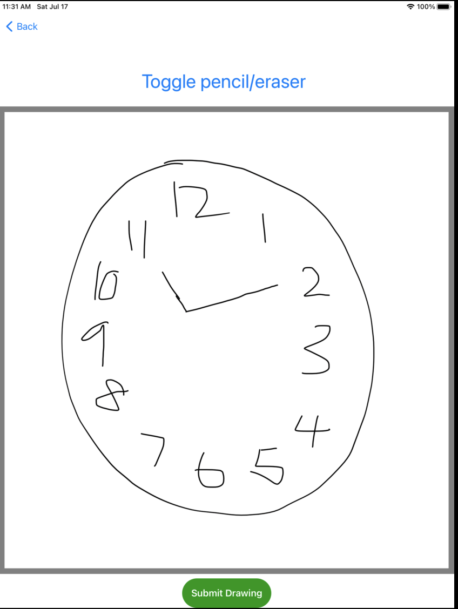
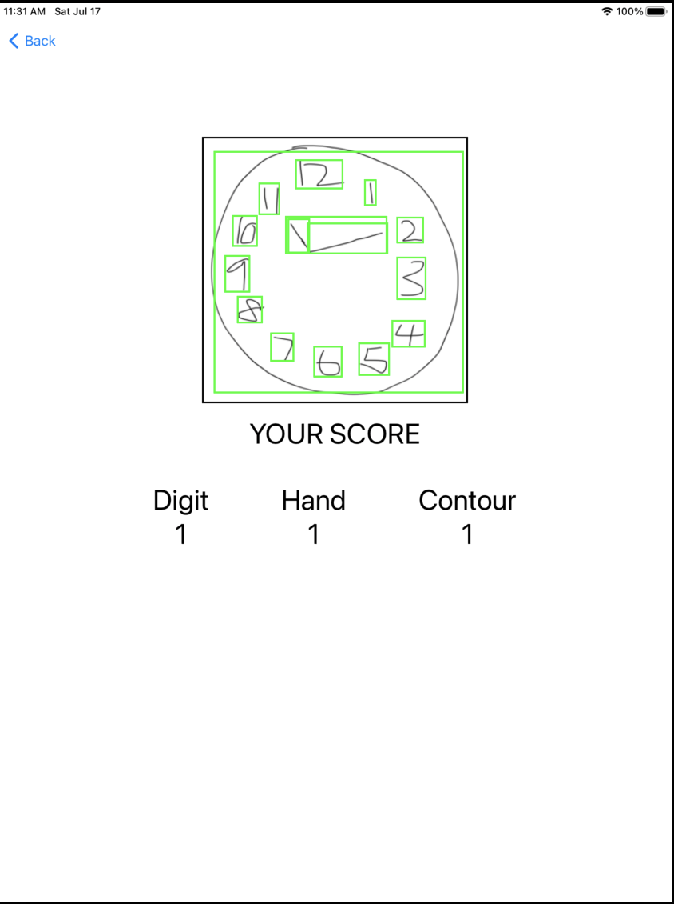
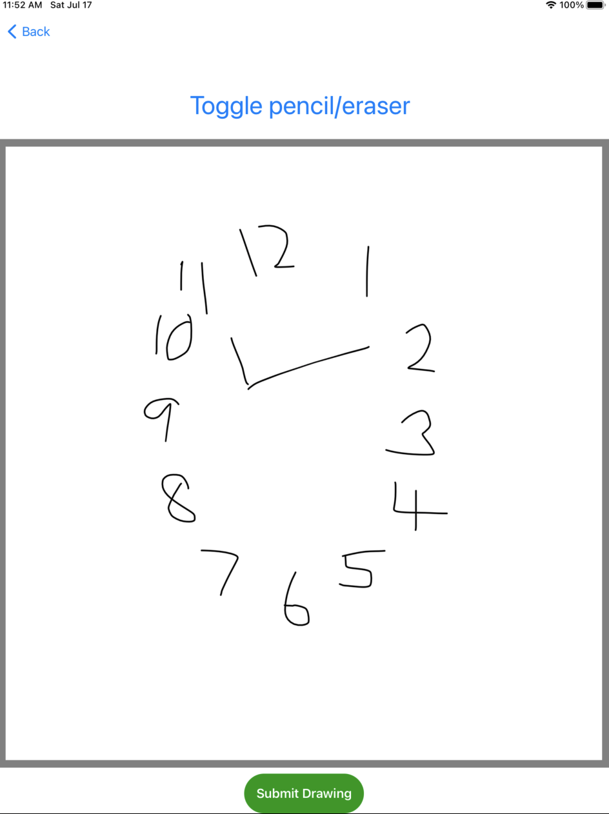
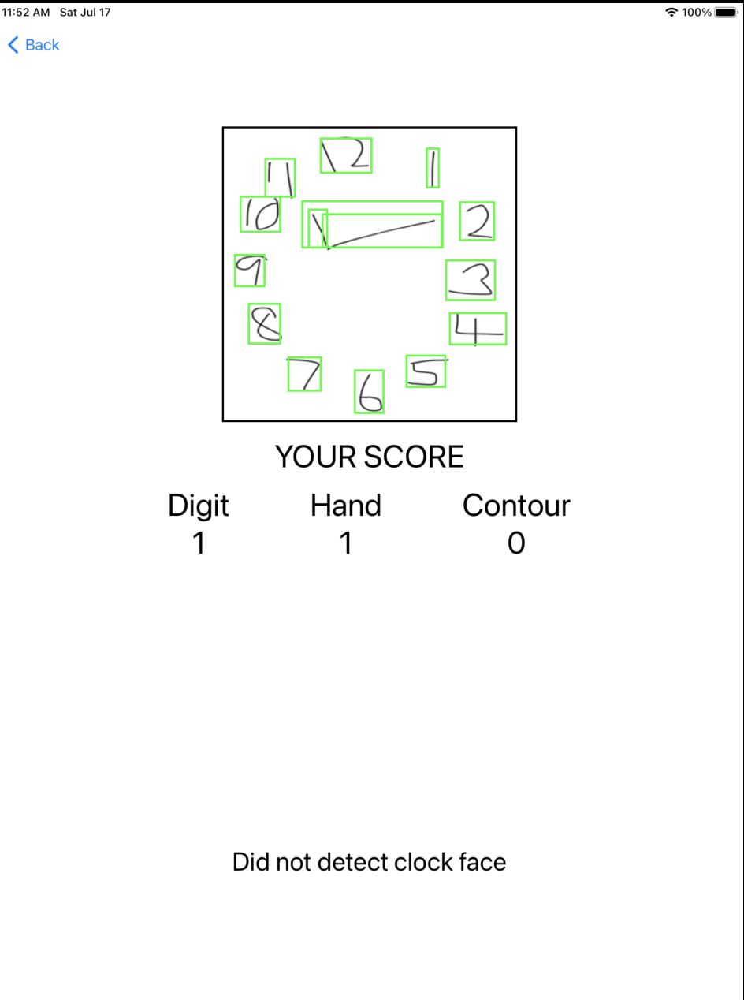

# Clock Scoring system on IOS

## Introduction
This repository contains an IOS demo app under the `clockscoring` folder and development codes under `python` folder. Model development is done using Pytorch 1.9.0 
and torchvision 0.10.0. The model used in the demo app is a quantised (backbone) Faster RCNN using mobilenet V3 backbone. User drawings are resized to 320x320 pixels before model inference. Inference on a IOS device takes around ~4s and achieves a Mean Average Precision score of (70.44 mAP points) at IOU(0.8:0.95:0.05). Examples of the app workflow as shown below on an ipad simulator device. Clock
images screenshots are graded based on the time 11:10.

  
  

## Prerequisites
- PyTorch 1.9 and torchvision 0.10
- Python 3.7 or above
- IOS Cocopods LibTorch 1.9.0 and LibTorchvision 0.10.0
- Xcode 12.5 or later

## Setting up for IOS 
Clone the project:

```
git clone https://github.com/yichong96/clock_scoring
cd clockscoring
```

Then run the commands 
```
pod install
open clockscoring.xcworkspace/
```
`pod install` will install libtorch and libtorchvision dependencies into the project.

## Build model
To build the quantised mobilenet v3 model from python, run the following commands. 
```
cd python
python train_mobilenetV3.py --num_epochs 30 --lr 0.01 --momentum 0.9 --weight_decay 0.0005 --batch_size 8 
```
`num_epochs`, `momentum`, `weight_decay` and `batch_size` are required model hyperparameters that have to be specified if `--tune` is not specified. Alternatively, the model can be trained by automatic hyperparameter optimisation by specifying `--tune`. `--tune` uses the RayTune hyperparameter optimisation 
library that does random search of hyperparameters and early stopping for poor performing models.

To use incorporate tuning, run the following commands.
```
python train_mobilenetV3.py --num_epochs 30 --tune --num_samples 15 --grace_period 10
``` 
where `num_samples` and `grace_period` are hyperparameters for tune's scheduling algorithm

### Optional training parameters
`--mixup` : blends images during model training with equal blending.

`--augment_data`: stocahstically augments images and their labels during training by random rotation of clock digits and reflection of clock hand.

## Scoring
One point is allocated for each of the following three criteria:
* Contour (1 pt): The clock face must be a circle with only minor distortion acceptable (e.g slight imperfection on closing the circle);
* Numbers (1 pt): All clock numbers must be present with no additional numbers; numbers must be in the correct order and placed in the approximate quadrants on the clock face; Roman numerals are acceptable; numbers can be placed outside the circle contour.
* Hands (1 pt): There must be two hands jointly indicating the correct time; the hour hand must be clearly shorter than the minute hand; hands must be centered within the clock face with their junction close to the clock centre.

### Scoring hyperparameters: 
`HAND_X_WIDTH`, `HAND_Y_WIDTH` : Determines width and height of bounding box with center at the mid point of the detected clock face. The mid point between the base of the short and long hand must lie within this bounding box to be considered as "centered".

`LONG_SHORT_THRESH` : The distance measured in pixels of the threshold for long and short hands to be considered 'distinct'.

## References 
- [Searching for MobileNetV3](https://arxiv.org/abs/1905.02244)
- [Tune: Scalable Hyperparameter Tuning](https://docs.ray.io/en/master/tune/index.html)
- [Faster R-CNN: Towards Real-Time Object Detection with Region Proposal Networks](https://arxiv.org/abs/1506.01497)
- [IOS-demo app in pytorch D2GO](https://github.com/pytorch/ios-demo-app/tree/master/D2Go)
- [mixup: Beyond Empirical Risk Minimization](https://arxiv.org/abs/1710.09412)
