# clock_scoring

This project aims to automate the scoring of hand drawn clocks for participants who take part in the Montreal Cognitive Assessment (MoCA) or Mini-Mental State Examination (MMSE) test. 

**Examples of hand drawn clocks by participants:**

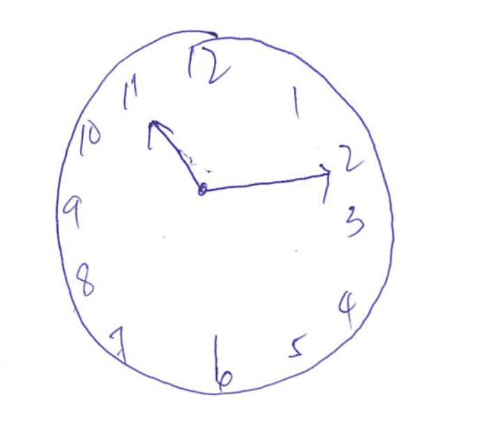 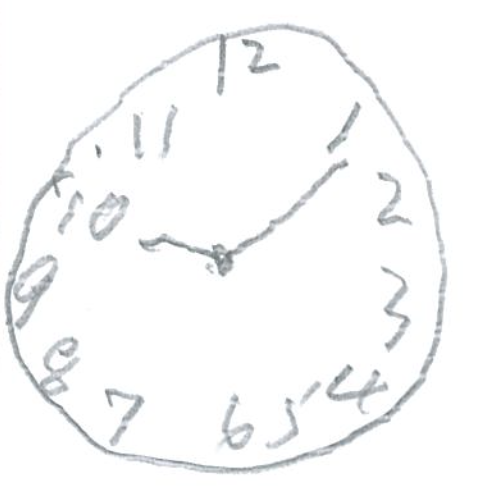  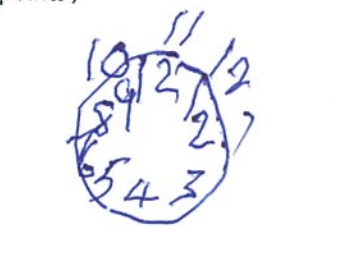 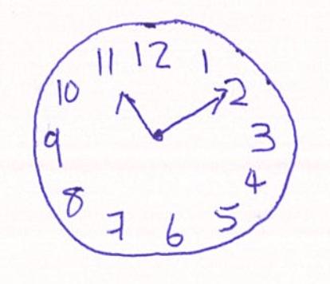 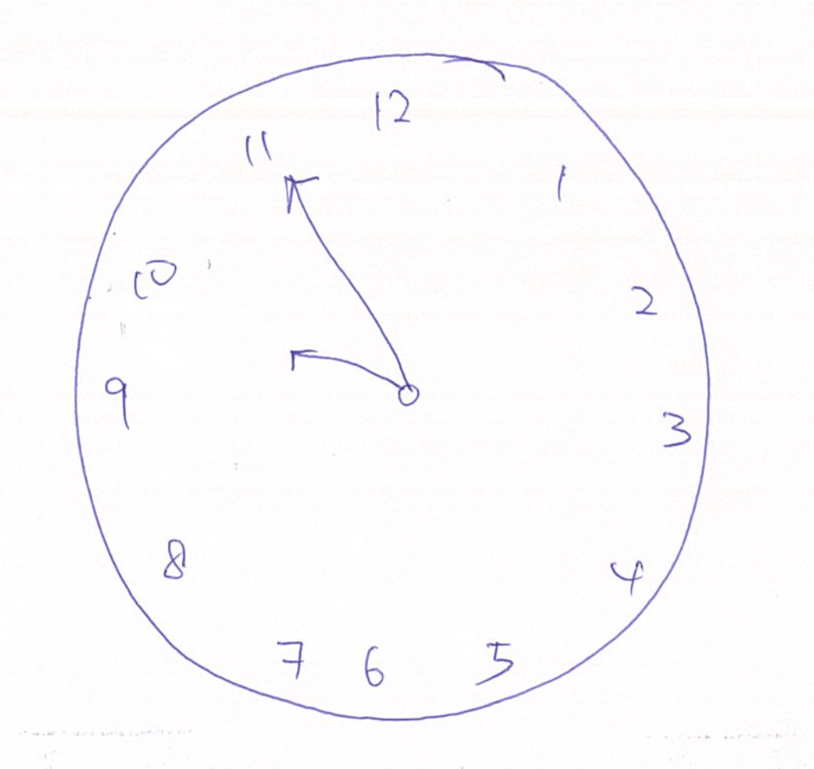 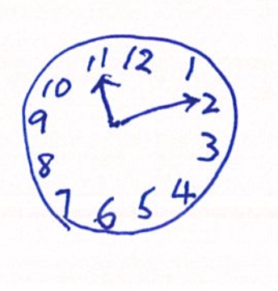 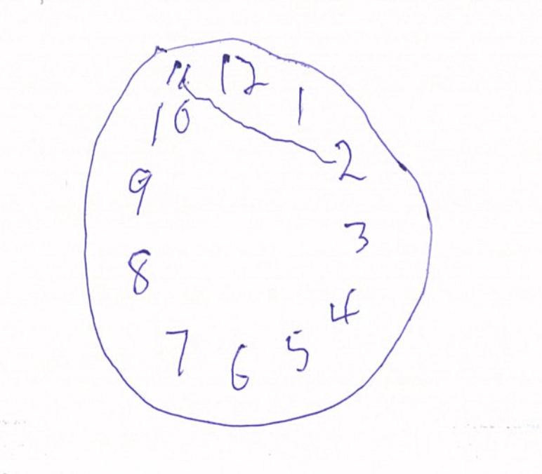 

## Scoring criteria
**Scoring:** One point is allocated for each of the following three criteria:
* Contour (1 pt): The clock face must be a circle with only minor distortion acceptable (e.g slight imperfection on closing the circle);
* Numbers (1 pt): All clock numbers must be present with no additional numbers; numbers must be in the correct order and placed in the approximate quadrants on the clock face; Roman numerals are acceptable; numbers can be placed outside the circle contour
* Hands (1 pt): There must be two hands jointly indicating the correct time; the hour hand must be clearly shorter than the minute hand; hands must be centered within the clock face with their junction clsoe to the clock centre

## Methodology
We integrate an object detection model into the scoring pipeline. Object detection is suited for such a task because of the scoring of the clock is also based upon the existence of clock elements (Eg. Digits, clock hand and clock face). The bounding boxes of each element from the detection model also aids in the localisation of elements, which in turn streamlines the process of developing a scoring algorithm. The object detection model is trained to detect the following elements

```python
class Classes(Enum):
	ONE = 1
	TWO = 2
	THREE = 3
	FOUR = 4
	FIVE = 5
	SIX = 6
	SEVEN = 7
	EIGHT = 8
	NINE = 9
	TEN = 10
	ELEVEN = 11
	TWELEVE = 12
	CONTOUR = 13
	HAND = 14
	TOP_LEFT_ARROW = 15
	TOP_RIGHT_ARROW = 16
	RIGHT_ARROW = 17
	LEFT_ARROW = 18
	UP_ARROW = 19
	DOWN_ARROW = 20
	BOTTOM_RIGHT_ARROW = 21
	BOTTOM_LEFT_ARROW = 22
```

In summary, we want the model to detect each digit in the clock (ONE - TWELEVE), the clock face (CONTOUR) and the clock hand (HAND) as well as the short/long hand within HAND (TOP_LEFT_ARROW - BOTTOM_LEFT_ARROW). 

## Experiments
We perform an ablation study on various object detection models available in pytorch; Namely, the faster - rcnn and Retina Net model. We use the mean average precision (mAP) over all IOU thresholds from 0.8:0.95 as the metric to optimise for. The iou threshold is set at very high values to because good localisation is needed in the downstream scoring task. We initialise the model with weights pretrained from COCO dataset and fine tune on our own clock drawings. Experiments with the models are all carried out using an initial lr of 0.01 with cosine annealing, weight decay value of 0.0005 and momentum value of 0.9. All models are trained for 20 epochs. mAP metric is carried out on the test set data.

Other than training the RetinaNet and Faster RCNN model, we tried to improve model performance by adding mixup and data augmentation techniques. The idea for mixup is adopted from [the Bag of Freebies for Object Detection paper](https://arxiv.org/abs/1902.04103) where pairs of images are added together by some convex combination of mixture weights. Mixup supposedly makes the model more robust to unusual scenes and makes detection of crowded objects easier. Data augmentation used in the experiments were the rotation of digits and reflecting the clock hand. In reflecting the clock hand, the long hand becomes the short hand and vice-versa. The labels also changes due to the reflection, thereby generating more data in the process. We conduct an ablation experiment to determine the effectiveness of both mixup and data augmentation. Each experiment was run for 5 times.


**Mixup**
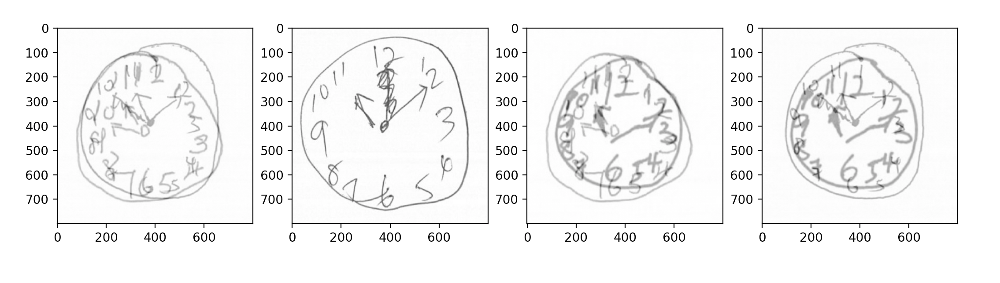
<figcaption>1st and 3rd and last image with mixup applied. Pixels are lighter for images with mixup compared to images without mixup (2nd image)</figcaption>

<br>
<br \>

**Data augmentation**
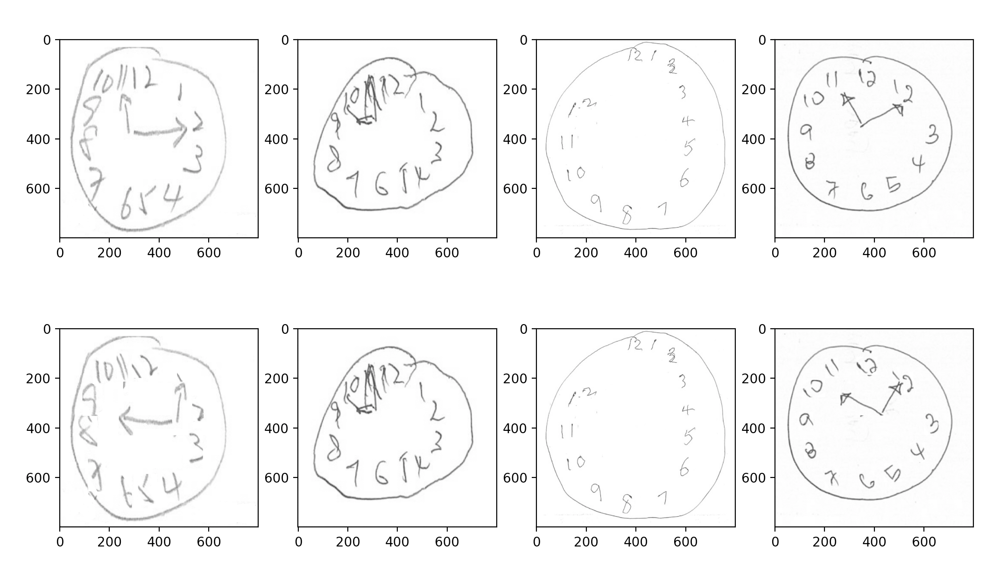
<figcaption>Top row shows the original image. The bottomw row shows data augmentation being applied on the 1st and last image. We see that after augmentation the digits are rotated and the hands are reflected about the x-axis.</figcaption>

<br>
<br \>

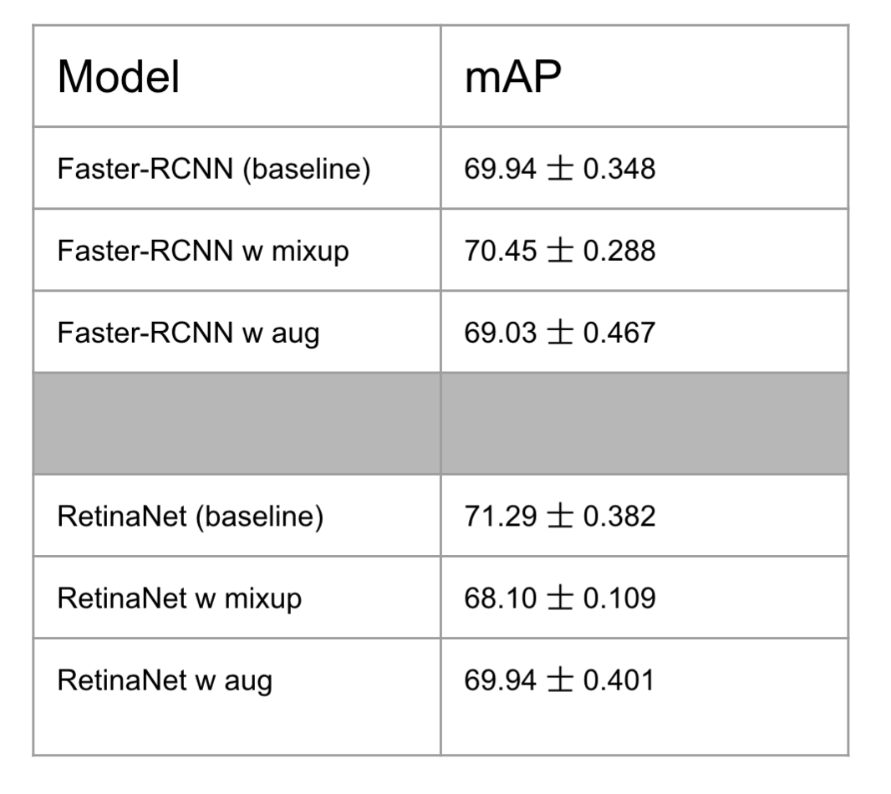
<figcaption>Experimental results on test set mAP over 5 trials</figcaption>

## Scoring
- 1 point given for clock face detected. This is equivalent to the CONTOUR class. 
- 1 point is given for the digits when the algorithm is able to detect exactly 12 digits and the digits are arranged in correct order. 
- 1 point is given when the clock hand class (14) and two subhands are detected, the hand is centered, the minute and hour hand distinguishable, and they are pointing to the correct. An example of this is shown below

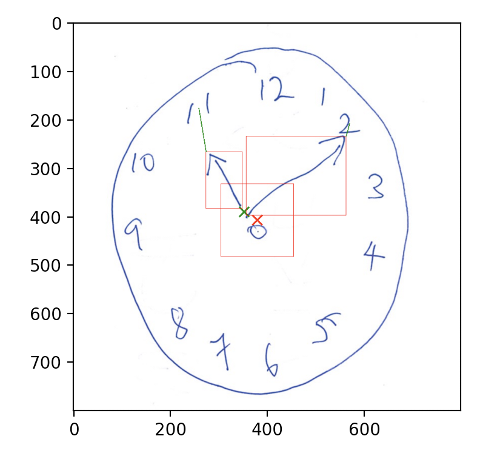 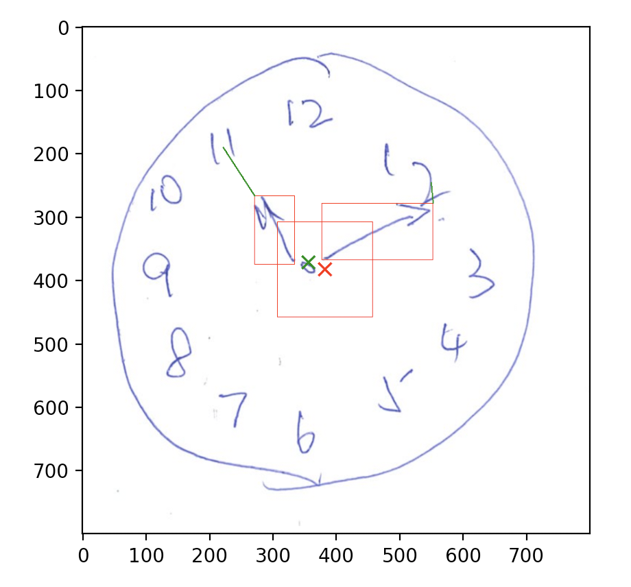
<figcaption>The red cross represents the center of the middle rectangle, which represents the threshold in which the clock hand should lie in. The green cross represents the center of the clock hands. It should lie within the red rectangle to be considered a point. The green lines coming out of the bounding box over the subhands describe the nearest digit that the hands are pointing to. Both clocks are awarded full 3 points by the grading system.</figcaption>
