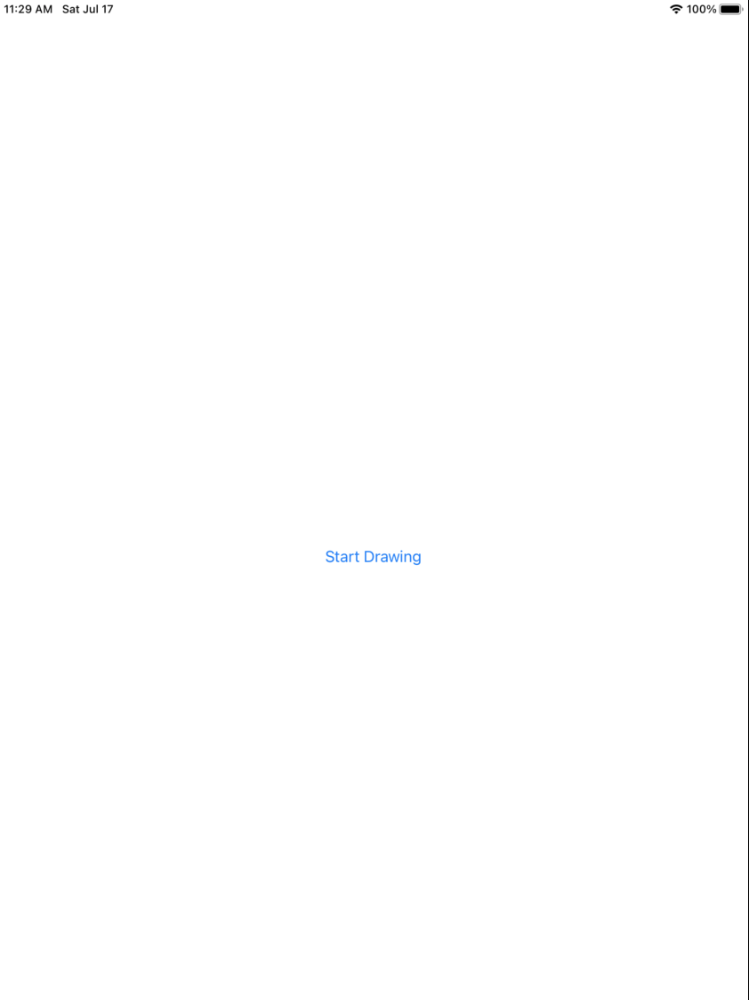

# Clock Scoring system on IOS

## Introduction
This repository contains an IOS demo app under the `clockscoring` folder and development codes under `python` folder. Model development is done using Pytorch 1.9.0 
and torchvision 0.10.0. The model used in the demo app is a quantised Faster RCNN using mobilenet V3 backbone. Model inference on a IOS device takes around ~4s and
achieving a Mean Average Precision score of (70.44 mAP points) at IOU(0.8:0.95:0.05). Examples of the app workflow as shown below on an ipad simulator device. Clock
images screenshots are graded based on the time 11:10.

   
  

## Prerequisites
- PyTorch 1.9 and torchvision 0.10
- Python 3.7 or above
- IOS Cocopods LibTorch 1.9.0 and LibTorchvision 0.10.0
- Xcode 12.5 or later

